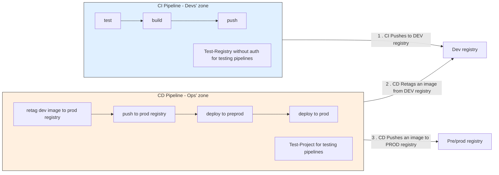

# CI vs CD

The split is: **CI writes only to the dev registry; CD reads from the dev registry and writes to production-grade
registries**.

**CI** pipelines run checks and build Docker images to the dev registry only. They never authenticate to pre/prod
registries or touch any production environment.

**CD** pipelines pull the CI-built image from the dev registry, retag it into the target environment's registry, and
deploy. CD is gated behind a release event — a deliberate, human-initiated action. CD never builds images; it only
retags and deploys.

Typical end-to-end flow for a prerelease:

1. Developer pushes tag `v1.2.3-rc.1` → `ci.yml` builds and pushes `<repo>:<sha>` and `<repo>:v1.2.3-rc.1` to the dev
   registry.
2. Developer (or someone from an Ops team) creates a GitHub prerelease from that tag → `cd-pre-release.yml` pulls from
   the dev registry, retags to `<preprod-registry>/<repo>:<sha>` and `:<tag>`, and deploys to pre/prod.

The dev registry is always an intermediate artifact store. CD never rebuilds from source.

## Static site as an OCI artifact — worked example

A static site has no Docker image, but the split is the same: CI publishes to the dev registry, CD pulls from it and
deploys. The difference is packaging — the built site becomes an OCI image so it is addressable by commit SHA.

**CI** (e.g. `ci-pages.yml`):

1. Build the site into a directory.
2. Package it as an OCI image (e.g. with `docker build` using a minimal `scratch` or `busybox` base, or with
   `umoci`/`crane`).
3. Push to the dev registry tagged with the full commit SHA:
   `ghcr.io/ivanov-gv/cg-map:<sha>`.
4. In test-run mode, push to `ttl.sh/<repo>:<sha>?ttl=24h` instead.

**CD** (e.g. `cd-pages.yml`):

1. Pull the image by SHA: `ghcr.io/ivanov-gv/cg-map:<sha>`.
2. Extract the files from the image layers.
3. Publish to the target (e.g. GitHub Pages via `actions/deploy-pages`).

No run IDs, no lookups, no polling. CD knows exactly what to deploy because the artifact is tagged by commit SHA.

**Retention and cleanup:**

- The test-run registry (`ttl.sh`) is ephemeral — images expire after the configured TTL.
- The dev registry (GHCR) uses count-based cleanup via a scheduled workflow with `actions/delete-package-versions`
  and `min-versions-to-keep`. GHCR has no time-based retention.
- Rollback means deploying an older SHA. If the image is still in the registry, CD deploys it. If it was cleaned up,
  rebuild from the older commit.

**The `workflow_run` acknowledgement exception:**

GitHub Pages has no release event, so CD cannot wait for one. Instead, `cd-pages` starts on CI's completion via
`workflow_run`, filtered to:

- Event: `push` (not `pull_request`, not `workflow_dispatch`).
- `head_branch`: the default branch.
- `conclusion`: `success`.

This exception must be recorded in the project's ADR and approved by the owner. It never fires for test runs.

GitHub records a deployment for any job that names an environment, even if the job publishes nothing. Let only the
publishing job name the environment, and do not trust the deployment history until it does.

## Example: GitHub + GHCR + Google Cloud

The setup these conventions were written for:

- **Dev registry:** GHCR. `ghcr.io/${{ github.repository }}:${{ github.tag }}` is a production-grade image ready to be
  deployed.
- **Pre/prod registry:** the target environment's Google Artifact Registry.
- **Deploy target:** Cloud Run pre/prod. CD workflows such as `cd-pre-release.yml` retag the image into Artifact
  Registry and deploy to Cloud Run.
- **Auth:** CD workflows use Workload Identity Federation (WIF). In test-run mode the WIF credentials resolve to a
  test-run GCP project (see [test-run model](test-run-model.md)).
- **Paths:** CD pulls only images under `ghcr.io/${{ github.repository }}`, with the release tag or commit SHA.
- **Prerelease flow:** pushing `v1.2.3-rc.1` makes `ci.yml` push `ghcr.io/<repo>:<sha>` and
  `ghcr.io/<repo>:v1.2.3-rc.1`. Creating the GitHub prerelease runs `cd-pre-release.yml`, which retags into the
  environment's Artifact Registry (`<preprod-registry>/<repo>:<sha>` and `:<tag>`) and deploys to Cloud Run pre/prod.
