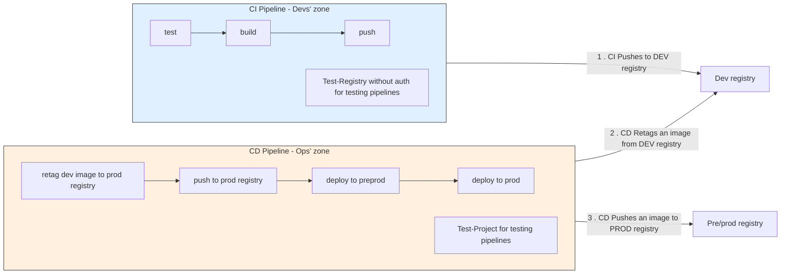

# CI vs CD

The split is: **CI writes only to the dev registry; CD reads from the dev registry and writes to production-grade
registries**.

**CI** pipelines run checks and build Docker images to the dev registry only. They never authenticate to pre/prod
registries or touch any production environment.

**CD** pipelines pull the CI-built image from the dev registry, retag it into the target environment's registry, and
deploy. CD is gated behind a release event — a deliberate, human-initiated action. CD never builds images; it only
retags and deploys.

Typical end-to-end flow for a prerelease:

1. Developer pushes tag `v1.2.3-rc.1` → `ci.yml` builds and pushes `<repo>:<sha>` and `<repo>:v1.2.3-rc.1` to the dev
   registry.
2. Developer (or someone from an Ops team) creates a GitHub prerelease from that tag → `cd-pre-release.yml` pulls from
   the dev registry, retags to `<preprod-registry>/<repo>:<sha>` and `:<tag>`, and deploys to pre/prod.

The dev registry is always an intermediate artifact store. CD never rebuilds from source.

## Without Docker images

A static site has no image, so a CI run's artifact takes the dev registry's place. The split stays the same. In
`ivanov-gv/cg-map`, CI holds read-only permissions and uploads the built site, and `cd-pages` downloads it by run ID,
copies it into its own run, and publishes it. It never checks out the application or rebuilds. CD must check the source:

- The run came from the expected workflow, concluded `success`, and came from the expected event. Environment-scoped
  variables hold the event and the artifact name, so a test artifact can never be released.
- A pushed run came from the default branch. A branch can widen its own copy of the workflow's push filter, so the filter
  alone does not prove this.
- No newer verified run exists, so that a slow older run cannot overwrite a newer deployment. Compare runs that hold an
  artifact, not the head of the branch: a later docs-only merge must not stop a deployment. A deployment's own commit is
  the branch head when CD ran, not the artifact's commit, so it cannot be used for this.

The artifact's retention sets the rollback window: rerun CD by hand with an older run ID.

A calling workflow is not a split: if CI calls CD, it is one run, and CI must grant the deployment permissions. Use a
separate run. Starting it automatically after CI, with `workflow_run`, is an exception to "triggered by a release or
manual trigger" that needs the owner's approval. `workflow_run` runs only from the default branch, so only a real merge
proves it. The merge that removes the old workflows can already deploy this way, so treat it as a production release.

GitHub records a deployment for any job that names an environment, even if the job publishes nothing. In `cg-map`, a
preparation job read its variables from the production environment, so a docs merge showed as a successful deployment
of a commit that was never published. Let only the publishing job name that environment, and do not trust the
deployment history until it does.

## Example: GitHub + GHCR + Google Cloud

The setup these conventions were written for:

- **Dev registry:** GHCR. `ghcr.io/${{ github.repository }}:${{ github.tag }}` is a production-grade image ready to be
  deployed.
- **Pre/prod registry:** the target environment's Google Artifact Registry.
- **Deploy target:** Cloud Run pre/prod. CD workflows such as `cd-pre-release.yml` retag the image into Artifact
  Registry and deploy to Cloud Run.
- **Auth:** CD workflows use Workload Identity Federation (WIF). In test-run mode the WIF credentials resolve to a
  test-run GCP project (see [test-run model](test-run-model.md)).
- **Paths:** CD pulls only images under `ghcr.io/${{ github.repository }}`, with the release tag or commit SHA.
- **Prerelease flow:** pushing `v1.2.3-rc.1` makes `ci.yml` push `ghcr.io/<repo>:<sha>` and
  `ghcr.io/<repo>:v1.2.3-rc.1`. Creating the GitHub prerelease runs `cd-pre-release.yml`, which retags into the
  environment's Artifact Registry (`<preprod-registry>/<repo>:<sha>` and `:<tag>`) and deploys to Cloud Run pre/prod.
