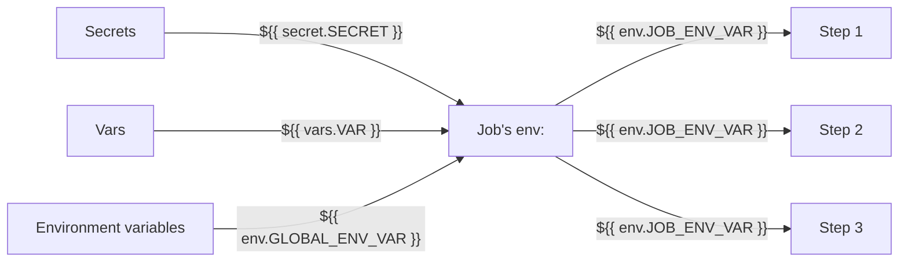

# Hide global var references in `env:` blocks



Each job declares an `env:` block that maps `secrets.*` and `vars.*` (or the platform's equivalents) into named env
vars. Steps then reference only `${{ env.* }}` in `with:` and `run:` blocks — never `secrets.*` or `vars.*` directly.
The benefit is that each step is a **self-contained block** — to understand or edit a step you don't have to scroll up
and cross-reference secret/var definitions.

GitHub Actions example:

```yaml

env:
  GLOBAL_ENV_VAR: value

jobs:
  - job1:
      env: # maps outside secrets and vars to job-scoped env vars
        - DOESNT_WORK: ${{ env.GLOBAL_ENV_VAR }} # <-- substitution from global env: DOESN'T WORK in ACT
        - JOB1_VAR2: ${{ secrets.GLOBAL_SECRET }}
        - JOB1_VAR2: ${{ vars.GLOBAL_VAR }}
      steps:
        - run: |
            LOCAL_VAR=${{ env.JOB1_VAR }} # explicitly shows that env.JOB1_VAR is defined in job1's env: section
            LOCAL_VAR2=LOCAL_VAR          # explicitly shows that LOCAL_VAR is a local variable
```
