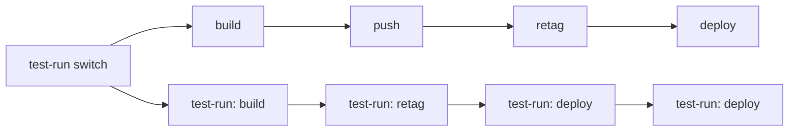

# Test-run model

Workflow diagram with a test-run switch:



Implementation example (GitHub Actions workflow):

```yaml
jobs:
  - switch:
      outputs:
        test_run: ${{ steps.test_run_switch.outputs.test_run }} # true or false
      steps:
        - # decide - default or test-run
        - # set outputs.test_run to true or false 
  - deploy:
      name: Deploy to preprod
      needs: [ switch ]
      if: ${{ needs.switch.outputs.test_run != 'true' }} # depends on switch
      env: &deploy-env        # env anchor
      # ...
      steps: &deploy-steps    # steps anchor
      # ...

  - deploy-test-run:
      name: (test-run) Deploy to preprod
      needs: [ switch ]
      if: ${{ needs.switch.outputs.test_run == 'true' }}
      environment: test-run   # test environment
      permissions:
        registry: read        # protects from accidental writes
      env: *deploy-env        # same envs
      steps: *deploy-steps    # same steps
```

Production and test-run jobs are deployed as **parallel pairs** that share a YAML-anchor step list
(e.g. `*build-and-push-steps`, `*retag-steps`, `*deploy-steps`). The pair is selected by
`needs.switch.outputs.test_run`. Both jobs run the **same steps**.

Safety comes from `environment: test-run` resolving secrets and vars to non-production targets —
for example `vars.ENV_REGISTRY` resolves to a public no-auth sink like `ttl.sh` in the test-run
environment, and WIF credentials resolve to a test-run GCP project. Reduced `permissions:`
(e.g. `packages: read` on GHCR) provide a second layer.

```yaml
  - deploy:
      # ...
      env: &deploy-env
        - ENV_REGISTRY: ${{ vars.ENV_REGISTRY }}
      steps: &deploy-steps
        - docker push ${{ env.ENV_REGISTRY }}/image:tag

  - deploy-test-run:
      # ...       
      environment: test-run
      permissions:
        registry: read
      env: *deploy-env
      steps: *deploy-steps    # same 'docker push', but to a test-run registry
```

This means a step that "actually runs" in the test-run job is fine, as long as its destination
comes from environment-scoped secrets or vars. Do **not** add step-level `if:` skips to make
test-run steps "no-op" — that defeats the purpose of exercising the same code path.

This model has a big disadvantage: outputs don't work because of the YAML anchors. Two jobs
share the same steps and envs list, but the default one needs to reference `needs.previous-job.outputs` and the
test-run one needs to reference `needs.previous-job-test-run.outputs`. For the GitHub Actions workaround, see
[outputs in test-run pairs](github-test-run-outputs.md).

A complete workflow using this model: [example GitHub workflow](github-example-workflow.md).
